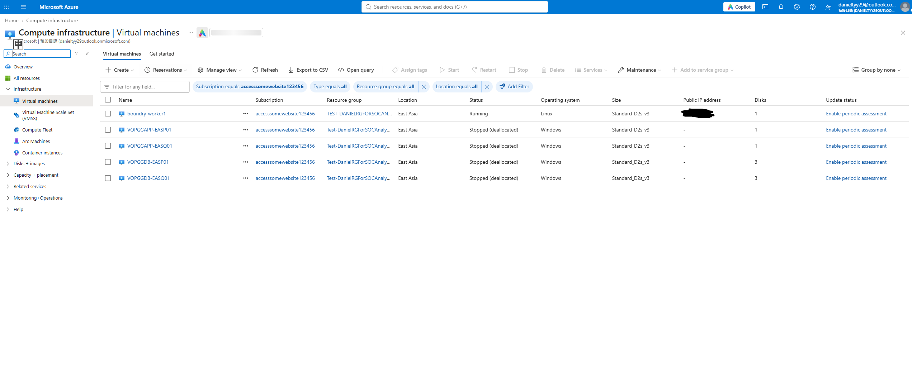

# CyberArk-Like-Company-Environment

# Project Overview
This project demonstrates the design and implementation of a segmented Azure cloud environment following enterprise security principles.

Management Zone

├── Apache Guacamole

└── Administrative Access

DMZ Zone

├── Windows Application Server

└── Public Web Services (IIS)

Internal Zone

├── SQL Server 2025

└── Future Security Services (Vault / Monitoring)

Application Gateway Zone

├── Application gateway with WAF installed

Administrative access is centralized through a dedicated management subnet, while application and database workloads are isolated using subnet segmentation and Network Security Groups (NSGs).

# Infrastructure Deployment Flow
## 1. Network Architecture

Created an Azure Virtual Network with three security zones:

Azure VNet (10.0.0.0/24)
 
├── DMZ1 (10.0.0.0/26)

├── MGMT1 (10.0.0.64/27)

└── INT1 (10.0.0.96/27)

└── AppGatewaySubnet (10.0.0.128/27)


Network Security Rules
Azure VNet
10.0.0.0/24

--------------------------------------------------
DMZ1
10.0.0.0/26
--------------------------------------------------

Inbound Rules

ALLOW
MGMT1 (10.0.0.64/27)
→ TCP 3389 (RDP)

ALLOW
AppGatewaySubnet (10.0.0.128/27)
→ TCP 80,443 (HTTPS)

DENY
All other inbound traffic

--------------------------------------------------
MGMT1
10.0.0.64/27
--------------------------------------------------

Inbound Rules

ALLOW
Home Public IP
→ TCP 22 (SSH)

ALLOW
Home Public IP
→ TCP 8080 (Guacamole)

DENY
All other inbound traffic

--------------------------------------------------
INT1
10.0.0.96/27
--------------------------------------------------

Inbound Rules

ALLOW
MGMT1 (10.0.0.64/27)
→ TCP 3389 (RDP)

ALLOW
DMZ1 (10.0.0.0/26)
→ TCP 1433 (SQL Server)

DENY
Internet
→ Any

DENY
All other inbound traffic

--------------------------------------------------
AppGatewaySubnet
10.0.0.128/27
--------------------------------------------------

Inbound Rules

ALLOW
Public Internet 
-> TCP 80,443 (HTTP, HTTPS)

DENY
All other inbound traffic

## 2. Deploy Security Infrastructure
Deployed five virtual machines across dedicated security zones to simulate a small enterprise environment.

| Hostname | Role | Zone |
|----------|------|------|
| boundry-worker1 | Management Server (Guacamole) | MGMT1 |
| VOPGGAPP-EASP01 | Windows Application Server | DMZ1 |
| VOPGGAPP-EASQ01 | Windows Application Server | DMZ1 |
| VOPGGDB-EASP01 | SQL Server 2025 Developer | INT1 |
| VOPGGDB-EASQ01 | SQL Server 2025 Developer | INT1 |

Security Design
Management services are isolated within the MGMT1 subnet.



## 3. Deploy Management Server and Access Portal

Connected to the Management Server hosted in the MGMT1 subnet and deployed the Apache Guacamole environment using Docker Compose.

The deployment was performed using a pre-configured `compose.yaml` file stored in the project repository Apache Guacamole\DockerCompose\compose.yaml.

### Deployment Steps

```bash
git clone <repository>
cd guacamole

docker compose up -d

docker run --rm guacamole/guacamole \
/opt/guacamole/bin/initdb.sh --mysql > initdb.sql

docker exec -i guac-sql mysql \
-u root \
-pStrongPassword123! \
guacamole_db < initdb.sql
```

### Components Deployed

- Guacamole Web Application
- guacd Proxy Service
- MySQL Database Backend

### Validation

Verified successful container deployment using:

```bash
docker ps
```

Confirmed browser access via:

```text
http://<Management-Server-IP>:8080/guacamole
```

### Purpose

This management server acts as a centralized administrative access platform, allowing browser-based access to internal infrastructure without exposing direct management ports to the Internet.

### Deployment Evidence


## 4. User Acceptance Testing (UAT)

To validate the deployment from an end-user perspective, a test user was invited to access the environment through Apache Guacamole.

The objective was to verify:

- Browser-based remote access
- Authentication functionality
- RDP connectivity to internal servers
- User experience and accessibility

The test user successfully connected to the target Windows Server via Apache Guacamole without requiring direct RDP access from the Internet.

To simulate vendor enviroment, I have created a group named QAaccess, where test user can see QA virtual machine on the VM list

### Test Result


### Outcome

✅ Successful authentication through Guacamole using testuser1 account with only QA server access

✅ Successful browser-based RDP session

✅ Internal server access without public RDP exposure

✅ Management subnet architecture validated
